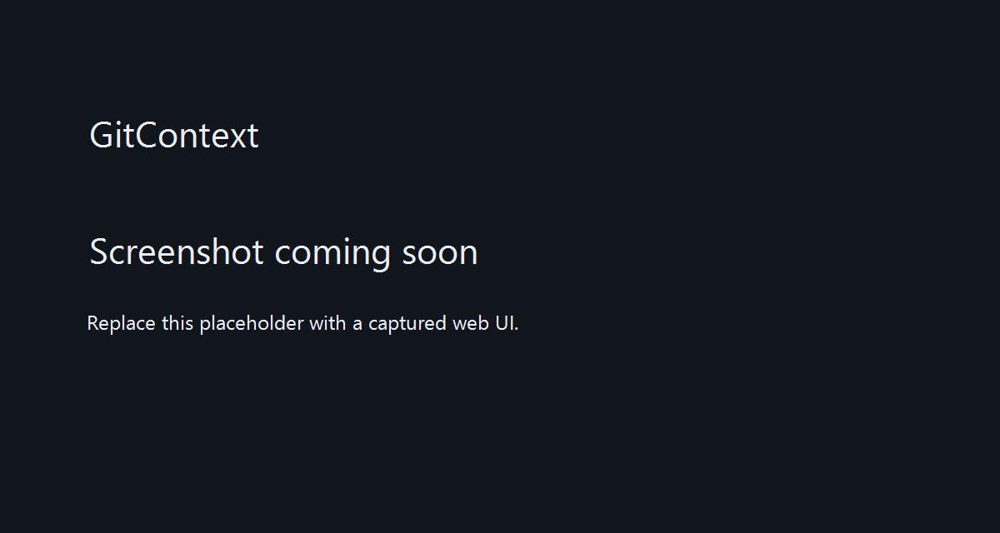
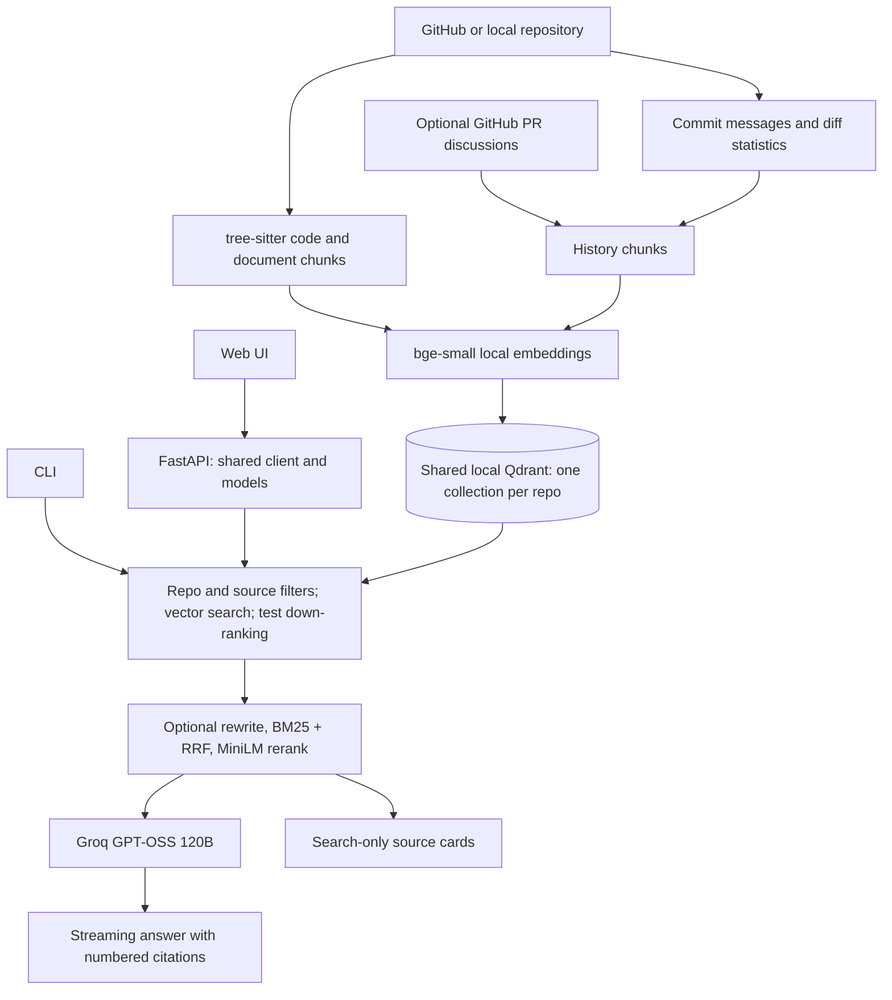

# GitContext

[](https://github.com/Mulasreeja15/gitcontext/actions/workflows/tests.yml)

**Ask a Python codebase how it works—and why it changed—with answers that cite the source.**

GitContext is a portfolio RAG project that measures retrieval choices instead of assuming more components produce better answers. Embedding and search run locally; Groq generates grounded answers from numbered excerpts.

## What it does

- Answers questions about Python GitHub repositories with clickable source citations.
- Keeps multiple repositories isolated in separate Qdrant collections.
- Retrieves commit history and optional GitHub PR discussions for “why” questions.
- Streams answers in a responsive web UI with search-only mode, source cards, and provenance.
- Exposes a FastAPI service with models loaded once, background indexing, and incremental updates.

## Demo



[Demo video — coming soon](#demo). The screenshot is a placeholder; replace it with a captured UI and add the recording link here.

## Results

Evaluated on the [`psf/requests`](https://github.com/psf/requests) library with **45 labelled questions**: exact identifiers, technical questions, and plain-English questions written the way a developer new to the codebase would ask them.

| Configuration | Recall@1 | Recall@3 | Recall@5 | MRR@10 | Median latency |
|---|---|---|---|---|---|
| Vector only (baseline) | 60% | 69% | 76% | 0.680 | 17 ms |
| **Vector + test down-ranking** (default) | **69%** | 76% | **91%** | **0.750** | **16 ms** |
| Hybrid (vector + BM25, RRF) | 42% | 62% | 73% | 0.561 | 17 ms |
| Hybrid + test down-ranking | 53% | 78% | 89% | 0.679 | 18 ms |
| Hybrid + test down-ranking + cross-encoder rerank | 44% | 69% | 82% | 0.592 | 1070 ms |
| **Vector + test down-ranking + LLM rewrite** (`--rewrite`) | 67% | 84% | 93% | **0.768** | ~1.3 s |
| Hybrid + test down-ranking + LLM rewrite | 56% | **87%** | **96%** | 0.725 | ~1.3 s |

**Recall@5 improved from 76% to 91% with no added latency, and up to 96% with LLM query rewriting.**

### Key findings

- **Test files were the main failure mode.** Test names like `test_HTTP_302_ALLOW_REDIRECT_GET` share vocabulary with questions, so they outranked the real implementation. Down-ranking tests was the single biggest win (Recall@5 76% to 91%, MRR 0.680 to 0.750) at zero latency cost.
- **BM25 hurts on natural-language questions.** Adding keyword search lowered MRR in every pairing (for example 0.750 to 0.679), because plain-English questions share few words with code. On an early 12-question set, hybrid search looked best; the larger, harder set reversed that conclusion.
- **BM25 becomes useful after LLM query rewriting.** Rewritten queries contain code identifiers, so keyword matching starts to work: Recall@5 rose from 93% to 96%, at some cost to top-1 precision.
- **LLM query rewriting rescues paraphrased questions.** "What stops it from bouncing between pages forever?" was not found by any other method; with rewriting it ranked first. Rewriting gave the best MRR (0.768) at the cost of one LLM call (~1.3 s).
- **General-purpose rerankers hurt code retrieval.** `ms-marco-MiniLM-L-6-v2` lowered MRR to 0.592 and added about 1 s per query; the larger `bge-reranker-base` was worse and 6x slower. These web-search models appear poorly matched to code; the history experiment below supports that explanation, without proving it.

### Known limitations

- **Vocabulary gap.** "How can I run my own code every time a response comes back?" fails in every configuration: the answer is *hooks*, a word the question never uses.
- **Implicit behavior.** "Why is a password being sent even though I never passed one?" (the answer is automatic `.netrc` lookup) is rarely found, because nothing in the question points to that mechanism.

### Answer quality: LLM judge

The judge measures correctness (1–5) against labelled gold context, faithfulness (0–1) to supplied sources, correct-source citation rate, and the fraction of answers with zero unsupported claims.

Current results for the 45-question code set, from the [answer-quality report](eval/judge_results.md). Both generation and judging use `openai/gpt-oss-120b`; correct-source citations are checked deterministically in Python. Skipped questions are excluded from score averages.

| Configuration | Mean correctness (1-5) | Mean faithfulness | Correct-source citations | Zero unsupported claims | Skipped |
|---|---|---|---|---|---|
| vector + test down-ranking | 4.67 | 0.852 | 75.6% | 53.3% | 0 |

**What the judge revealed**

- Answers are usually correct, but about 15% of claims are not backed by the cited sources: the LLM adds knowledge from training, such as urllib3 internals.
- A citation-parser bug initially reported only 51% correct-source citations. Investigating the suspicious result fixed the rate to 75.6%; the remaining misses cite valid code outside the narrow evaluation labels.
- The “hooks” question misses the retrieval labels but is answered correctly from documentation, showing that retrieval metrics can underestimate the system.
- A manual spot-check found that the judge marked an off-topic answer to the `.netrc` password question as correct. Judge scores are estimates, and using the same model to generate and judge is a known source of bias; a different `JUDGE_MODEL` can reduce self-preference bias.

### History retrieval: 8 questions

Evaluated on eight hand-labelled Requests commit questions, independently of the 45-question code set. [Full report](eval/history_questions_results.md) · [Questions and label verification](eval/history_labels.md).

| Configuration | Recall@1 | Recall@3 | Recall@5 | MRR@10 | Median latency |
|---|---|---|---|---|---|
| Vector only (Phase 1 baseline) | 88% | 88% | 88% | 0.875 | 31 ms |
| Vector + test down-ranking | 88% | 88% | 88% | 0.875 | 33 ms |
| Hybrid (vector + BM25, RRF) | 88% | 88% | 88% | 0.889 | 54 ms |
| Hybrid + test down-ranking | 88% | 88% | 88% | 0.889 | 54 ms |
| Hybrid + test down-ranking + rerank | 100% | 100% | 100% | 1.000 | 979 ms |


The MiniLM reranker lowered code Recall@5 from 89% to 82%, but improved history Recall@5 from 88% to 100%. Commit messages resemble the prose used in web-search training more closely than source code does, which supports the domain-mismatch explanation. **Eight selected questions are a small sample**, not evidence of a general history-retrieval guarantee. Published latencies depend on hardware and cache state.

## Architecture



Functions, classes and methods carry file/symbol context headers. Small classes stay intact; large classes get a summary and method chunks. Chunks include line numbers and last-changing commit metadata (author names, never emails). History stores messages and short diff statistics, not full diffs. All settings live in [`gitcontext/config.py`](gitcontext/config.py).

## Quick start

Python 3.12 is the tested version (also used by CI); Git is required. From PowerShell:

```powershell
git clone https://github.com/Mulasreeja15/gitcontext.git
cd gitcontext
python -m venv .venv
.\.venv\Scripts\Activate.ps1
.\.venv\Scripts\python.exe -m pip install -r requirements.txt
.\.venv\Scripts\python.exe main.py index https://github.com/psf/requests
.\.venv\Scripts\python.exe main.py serve --host 127.0.0.1 --port 8000
```

On Linux/macOS, activate with `source .venv/bin/activate` and use `.venv/bin/python`. The first index downloads the embedding model; reranking downloads MiniLM on first use. Search needs no API key. For answers or query rewriting, configure `GROQ_API_KEY` in your local `.env` (loaded by python-dotenv); never commit credentials. Optional PR import uses `GITHUB_TOKEN`.

### Docker

```powershell
docker compose up --build
```

Compose reads your local `.env`, exposes port 8000, and mounts `./data` at `/app/data`. The image installs CPU-only PyTorch and Git, and downloads both embedding and reranking models during the build. Model files live outside the data volume; runtime model loading uses the cached files. `.dockerignore` excludes local data, credentials, Git history, and the virtual environment. The first build needs network access and takes time.

Open **http://localhost:8000/** and use **+ Add repository** to index a public Python GitHub repository. Docker and host processes must not open the same local Qdrant folder simultaneously.

## Web UI

Select a repository in the header. **+ Add repository** opens a modal; enter `https://github.com/pallets/click`, press **Index**, and watch cloning/chunking/embedding progress. The new repository is selected when indexing finishes. Escape, the close button, or the backdrop closes the modal without cancelling indexing.

Ask a question (Enter submits; Shift+Enter adds a line) or use **Search only** without Groq. Rewrite, BM25, Rerank, and Include tests start off. Select **Code / History / All** to choose sources. Streamed citations jump to collapsible source cards with code, scores, lines, and Git provenance. The UI follows your system light/dark theme and reports rate limiting, empty indexes, stale indexes, and repositories with little Python code.

## CLI usage

The examples below use `python` from the activated environment. Coding tasks should use `.venv\Scripts\python.exe` explicitly.

```powershell
python main.py index https://github.com/psf/requests
python main.py index data\repos\requests
python main.py search "where is the timeout handled" -k 6
python main.py ask "How are redirects followed?"
python main.py search "timeout" --bm25 --include-tests
python main.py ask "What stops endless redirects?" --rewrite
python main.py ask "How are redirects followed?" --rewrite --bm25
python main.py search "TLS verification" --rerank
python main.py search "HTTPAdapter" --since 2024-03-02 --author "Author Name"
python main.py search "Why did the character detector change?" --sources history
python main.py search "TLS connection pool verification" --sources all --bm25
python main.py search --help
python main.py serve --host 0.0.0.0 --port 8000
```

`--since` is inclusive from midnight UTC; `--author` matches an exact, case-sensitive last-author name. Filters apply to vector and BM25 candidates. `--include-tests` disables the default penalty; there are no `--no-bm25` or `--no-rerank` flags.

### Multiple repositories and incremental updates

```powershell
python main.py index https://github.com/pallets/click
python main.py search "How are arguments parsed?" --repo pallets/click
python main.py ask "How do command groups work?" --repo pallets/click
python main.py repos
python main.py status --repo pallets/click
python main.py update --repo pallets/click
python main.py update data\repos\requests --repo psf/requests
python main.py remove pallets/click
```

Search, ask, status and update default to `psf/requests`. Collections use `repo__<owner>__<name>` and states use `data/index_state/<owner>__<name>.json`. Retrieval/BM25 and rewrite/judge caches are scoped per repository. Local repositories use the remote identity, or `local/<directory>` without one. `index` replaces only the selected repository; `remove` preserves the source checkout.

Full indexing saves repository identity, path, remote, commit, timestamp, model, and chunk count. Update pulls managed clones with `--ff-only`, then replaces only supported changed files, handling deletion and renames. Commit edits before updating. Missing state, incompatible schema/model, unavailable commit history, or interrupted updates trigger a full rebuild. Status compares local HEAD and working-tree changes; it does not fetch remote changes. Limits are **200 MB on disk including Git history** and **20,000 total chunks**.

**Use one server worker. Stop the server before CLI storage commands**, including retrieval and evaluation: local Qdrant locks the shared folder. While serving, use the API's shared client for indexing, updating and removing repos.

### Index history

```powershell
python main.py index-history --repo psf/requests --commits-only
python main.py index-history --repo pallets/click --unshallow --commits-only
python main.py index-history --repo psf/requests
```

The last `HISTORY_MAX_COMMITS=500` commits are examined; only commits touching supported paths are included. Web-added repositories use `--depth 1`; earlier history needs explicit `--unshallow` (`git fetch --unshallow`). Without it, shallow commit indexing is skipped with a notice. Full-history fetching can exceed the disk limit.

Without `GITHUB_TOKEN`, PR indexing skips gracefully. With a token, up to `PR_MAX=200` merged PRs include titles, bodies, labels, changed files, issue/review comments and review summaries. Pagination and rate limits are handled; raw responses cache for one day under `data/github_cache/<owner>__<name>/`, without tokens or authorization headers. `--commits-only` avoids the GitHub API. Run history indexing again after new commits/discussions; code updates preserve history when the embedding model stays the same.

## API

Interactive API documentation: **http://localhost:8000/docs**.

```powershell
Invoke-RestMethod -Uri 'http://localhost:8000/health'
Invoke-RestMethod -Uri 'http://localhost:8000/repos'
$body = @{ query = 'where is the timeout handled'; repo = 'psf/requests'; k = 6; sources = 'code' } | ConvertTo-Json
Invoke-RestMethod -Method Post -Uri 'http://localhost:8000/search' -ContentType 'application/json' -Body $body
$index = @{ repo_url = 'https://github.com/pallets/click' } | ConvertTo-Json
Invoke-RestMethod -Method Post -Uri 'http://localhost:8000/index' -ContentType 'application/json' -Body $index
Invoke-RestMethod -Uri 'http://localhost:8000/index/status'
Invoke-RestMethod -Method Post -Uri 'http://localhost:8000/reindex'
Invoke-RestMethod -Method Delete -Uri 'http://localhost:8000/repos/pallets/click'
```

| Endpoint | Behavior |
|---|---|
| `GET /health?repo=psf/requests` | Status, repo name, chunk count, stale flag and indexed commit. |
| `GET /repos` | Indexed repositories, counts, freshness and language/history notices. |
| `POST /index` | Validate public HTTPS GitHub URL; background clone/index, returns 202. |
| `GET /index/status` | State (`idle/cloning/chunking/embedding/done/error`), repo, progress and error. |
| `DELETE /repos/{owner}/{name}` | Remove index/state and cached retrieval data. |
| `POST /reindex` | Incrementally update the default saved repository. |
| `POST /search` | Ranked hits with text, metadata, scores and timings. |
| `POST /ask` | Answer, numbered sources and timings. |
| `POST /ask/stream` | SSE: `sources`, then `token`, with `status`, `done`, or `error` events. |

Search/answer bodies accept nonempty `query`, `k` (1–20; default 6), optional `repo`, `sources` (`code/history/all`), `since`, `author`, and booleans `bm25`, `rerank`, `rewrite`, `include_tests` (default false). Invalid inputs return 422, busy indexing returns 409, and empty indexes return 503. Groq calls retry 429 responses; the stream emits status messages while waiting. Job status is in memory and resets on restart. The server shares one Qdrant client and embedder with per-repo retrieval caches; optional reranking loads once on demand.

## Evaluation and tests

```powershell
python evaluate.py
python evaluate.py --with-rewrite --details
python evaluate.py --questions eval/history_questions.jsonl --details
python check_labels.py
python judge.py --limit 3
python judge.py --rewrite
python judge.py --no-cache
$env:PYTHON_DOTENV_DISABLED = '1'
.\.venv\Scripts\python.exe -m pytest -q
```

Retrieval reports go to `eval/results.md` and `eval/history_questions_results.md`. Judge reports go to `eval/judge_results.md`, with a resumable JSONL cache. Judge and rewrite evaluation call Groq; ordinary retrieval evaluation does not. The unit suite mocks models and external calls and uses temporary Git repositories/in-memory Qdrant. CI runs Python 3.12 with CPU PyTorch and offline model settings; tests require no API keys, downloaded models, or network.

## Known limitations

- Python is the supported code language; other repositories mostly contribute documentation.
- Natural-language vocabulary gaps and implicit behavior remain hard retrieval cases; see the measured failures above.
- The reranker is slow and usually harmful on code; history gains need validation on a larger set.
- Citations and judge scores help inspect grounding, but do not guarantee correct answers. The default judge shares the answer model's biases.
- Git history/PR discussions may be incomplete; shallow clones, missing tokens and stale caches limit coverage.
- Local Qdrant supports one process; the service is intended for local use and has no authentication or production deployment hardening.
- GitHub/Groq rate limits constrain import and answer throughput. Job progress is not persisted across restarts.

## Roadmap

- [x] Syntax-aware RAG, multi-repo isolation, metadata filters and incremental indexing
- [x] Streaming FastAPI service and accessible, dependency-free web UI
- [x] Commit/PR sources, retrieval ablations and cached LLM-judge tooling
- [x] Docker packaging and offline unit-test CI
- [ ] Publish the demo recording, real screenshot and answer-quality results
- [ ] Expand history evaluation and compare code-trained rerankers
- [ ] Add more language parsers and stronger grounding/citation evaluation
- [ ] Add authentication and persistent background jobs for shared deployments

Python · tree-sitter · sentence-transformers · Qdrant · rank-bm25 · FastAPI · Groq

## Diagnostics and reproducible installs

`requirements-lock.txt` pins the packages from the working Windows virtual environment,
excluding editable/local packages (pywin32 has a Windows-only marker). It reproduces the tested environment; use
Python 3.12 and install with:

```powershell
.\.venv\Scripts\python.exe -m pip install -r requirements-lock.txt
.\.venv\Scripts\python.exe main.py doctor --offline
python main.py doctor
```

Doctor checks Python (warns outside 3.11–3.12), package imports, whether the Groq
key is set, database availability, and each indexed repository's collection and
freshness. It prints a fix for each warning. The default doctor makes a tiny
Groq request; `--offline` skips it. Credentials are never printed.

Groq connections reuse a requests.Session. Connection/timeouts and HTTP
500/502/503/504 retry with capped exponential backoff, sharing the six-attempt
budget with 429 retries. Streams may reconnect before their first token; once
tokens have been emitted, a failure is surfaced instead of replaying text. Judge
answers and each finished judgment are saved immediately so reruns resume cached
work. Judge-only contexts use four sources, 1,500 characters per source and 3,000
characters of gold context, retrying at half size on 413 before recording a skip.

### Local database locks and optional Qdrant server

Local mode remains the default and permits one process. A lock error now gives
a short message: stop the other GitContext process using **Ctrl + C** in the
server terminal. Alternatively, `taskkill /F /T /IM python.exe` stops **all**
Python processes; use it only when that is intended. Never delete lock files
while another process owns the database.

Set `QDRANT_URL` to use a Qdrant server instead of `data/qdrant`. In PowerShell:

```powershell
$env:QDRANT_URL = 'http://localhost:6333'
python main.py doctor --offline
```

Compose keeps local mode by default. To enable its optional Qdrant service:

```powershell
$env:QDRANT_URL = 'http://qdrant:6333'
docker compose --profile qdrant up --build
```

The server persists collections in the named `qdrant_storage` volume and exposes
6333 to host clients (which use `http://localhost:6333`). The API still owns one
shared client/model set. Repo states/checkouts/cache files remain in the data
mount. Existing local collections are not automatically migrated: index the
repositories in server mode. Server mode supports concurrent processes; the
local-mode storage restrictions elsewhere in this README do not apply to it.
If the Qdrant service is not ready at application startup, start it first with
`docker compose --profile qdrant up -d qdrant`, then start GitContext.
