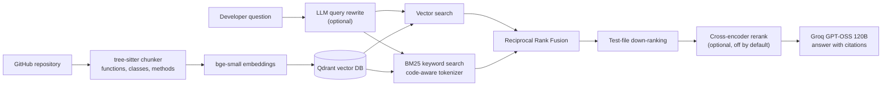

# GitContext

**Ask questions about any Python codebase and get answers grounded in the actual source, with file and line citations.**

GitContext is a retrieval-augmented generation (RAG) system for code. It parses a repository into functions, classes and methods, indexes them with hybrid semantic and keyword search, and answers developer questions like *"How does this library decide whether to follow a redirect?"* by citing the exact code it used.

Every retrieval technique in the pipeline was **measured with an evaluation harness**, and only the ones that improved results are on by default.

## Results

Evaluated on the [`psf/requests`](https://github.com/psf/requests) library with a labelled question set (12 questions: natural-language questions and exact identifiers).

| Configuration | Recall@1 | Recall@3 | Recall@5 | MRR@10 | Median latency |
|---|---|---|---|---|---|
| Vector search only (baseline) | 50% | 58% | 67% | 0.591 | 28 ms |
| + BM25 hybrid (RRF fusion) | 42% | 50% | 75% | 0.526 | 29 ms |
| + Test-file down-ranking | 50% | 67% | **100%** | 0.662 | 21 ms |
| + Cross-encoder rerank (MiniLM) | 42% | 75% | 75% | 0.574 | 1156 ms |
| + LLM query rewriting (no reranker) | 50% | **92%** | **100%** | **0.697** | 1631 ms |

**Recall@5 improved from 67% to 100%, and MRR from 0.591 to 0.697.**

### Key findings

- **Test files were the main failure mode.** Test names like `test_HTTP_302_ALLOW_REDIRECT_GET` share vocabulary with questions, so they outranked the real implementation. Down-ranking tests was the single biggest win (Recall@5 75% to 100%) at almost no latency cost.
- **BM25 alone made things worse before it made them better.** Keyword search amplified the test-file problem (test files are full of query words). Combined with test down-ranking, it surfaced exact identifiers that vector search missed.
- **General-purpose rerankers hurt code retrieval.** `ms-marco-MiniLM-L-6-v2` lowered MRR to 0.574 and added 1.2 s per query. The larger `bge-reranker-base` was worse (MRR 0.503) and 6x slower. Both are trained on web search data, so the problem is domain mismatch, not model size. Reranking is kept as an optional `--rerank` flag.
- **LLM query rewriting helps natural-language questions most.** It turns "how does requests guess the encoding of a response" into code-like search terms (rank 4 to 2), but can add noise to queries that are already exact identifiers.

## Architecture



## How it works

1. **Syntax-aware chunking.** Python files are parsed with tree-sitter and split at real boundaries: one chunk per function, class or method. Large classes become a summary chunk (signature, docstring, method list) plus one chunk per method. Each chunk carries a context header (`File: sessions.py / Method: SessionRedirectMixin.resolve_redirects`) so exact names are easy to match.
2. **Embedding and storage.** Chunks are embedded locally with `BAAI/bge-small-en-v1.5` and stored in a local Qdrant collection with file path, line numbers and symbol names as metadata.
3. **Hybrid retrieval.** Each query runs through vector search and BM25. The BM25 tokenizer is code-aware: it keeps whole identifiers and also splits `snake_case` and `camelCase`, so `resolve_redirects` matches a question about "redirects".
4. **Rank fusion and test handling.** Rankings are merged with Reciprocal Rank Fusion, and test files are down-weighted, because "how does X work" questions should surface implementation code.
5. **Grounded answers.** The top chunks are sent to an LLM with strict rules: answer only from the numbered sources, cite them inline, and say so when the answer isn't there.

## Quick start

```bash
git clone https://github.com/Mulasreeja15/gitcontext.git
cd gitcontext
python -m venv .venv
.venv\Scripts\activate            # macOS/Linux: source .venv/bin/activate
pip install -r requirements.txt
```

Create a `.env` file with a free [Groq](https://console.groq.com) API key:

```
GROQ_API_KEY=your_key_here
```

## Usage

```bash
# Index a repository (Git URL or local folder)
python main.py index https://github.com/psf/requests

# Retrieval only: see which code chunks come back
python main.py search "where is the timeout handled"

# Full RAG: answer with citations
python main.py ask "How does requests decide whether to follow a redirect?"

# Optional retrieval flags
python main.py ask "..." --rewrite          # LLM query rewriting
python main.py ask "..." --rerank           # cross-encoder reranking
python main.py search "..." --no-bm25       # vector search only
python main.py search "..." --include-tests # don't down-rank tests
```

## Evaluation

```bash
python evaluate.py                  # ablation over all retrieval configurations
python evaluate.py --with-rewrite   # include LLM query rewriting
python evaluate.py --details        # rank of the first correct result per question
```

Questions and expected answers live in `eval/questions.jsonl`. Each expected answer is a file and symbol, such as `src/requests/sessions.py::resolve_redirects`. Results are written to `eval/results.md`.

## Project structure

```
gitcontext/
├── chunker.py     # tree-sitter syntax-aware chunking
├── ingest.py      # clone/walk repositories
├── store.py       # embeddings + Qdrant vector store
├── retriever.py   # hybrid search, RRF, test down-ranking, reranking
├── answer.py      # LLM answers and query rewriting
└── config.py      # all settings in one place
main.py            # CLI: index, search, ask
evaluate.py        # evaluation harness (Recall@K, MRR, latency)
eval/              # labelled questions and results
```

## Tech stack

Python · tree-sitter · sentence-transformers · Qdrant · rank-bm25 · Groq (GPT-OSS 120B)

## Roadmap

- [x] Syntax-aware chunking, embeddings, vector search, cited answers
- [x] Hybrid BM25 + vector retrieval, RRF, test down-ranking, reranker and query-rewrite experiments
- [ ] Larger evaluation set (50+ questions) and LLM-judged answer faithfulness
- [ ] FastAPI backend, web interface, incremental re-indexing from git diffs
- [ ] Commit history and pull request discussions as additional sources