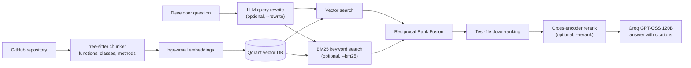

# GitContext

**Ask questions about any Python codebase and get answers grounded in the actual source, with file and line citations.**

GitContext is a retrieval-augmented generation (RAG) system for code. It parses a repository into functions, classes and methods, retrieves the code relevant to a developer's question, and answers questions like *"How does this library decide whether to follow a redirect?"* by citing the exact code it used.

Every retrieval technique in the pipeline was **measured on a labelled evaluation set**, and only the ones that improved results are on by default.

## Results

Evaluated on the [`psf/requests`](https://github.com/psf/requests) library with **45 labelled questions**: exact identifiers, technical questions, and plain-English questions written the way a developer new to the codebase would ask them.

| Configuration | Recall@1 | Recall@3 | Recall@5 | MRR@10 | Median latency |
|---|---|---|---|---|---|
| Vector only (baseline) | 60% | 69% | 76% | 0.680 | 17 ms |
| **Vector + test down-ranking** (default) | **69%** | 76% | **91%** | **0.750** | **16 ms** |
| Hybrid (vector + BM25, RRF) | 42% | 62% | 73% | 0.561 | 17 ms |
| Hybrid + test down-ranking | 53% | 78% | 89% | 0.679 | 18 ms |
| Hybrid + test down-ranking + cross-encoder rerank | 44% | 69% | 82% | 0.592 | 1070 ms |
| **Vector + test down-ranking + LLM rewrite** (`--rewrite`) | 67% | 84% | 93% | **0.768** | ~1.3 s |
| Hybrid + test down-ranking + LLM rewrite | 56% | **87%** | **96%** | 0.725 | ~1.3 s |

**Recall@5 improved from 76% to 91% with no added latency, and up to 96% with LLM query rewriting.**

### Key findings

- **Test files were the main failure mode.** Test names like `test_HTTP_302_ALLOW_REDIRECT_GET` share vocabulary with questions, so they outranked the real implementation. Down-ranking tests was the single biggest win (Recall@5 76% to 91%, MRR 0.680 to 0.750) at zero latency cost.
- **BM25 hurts on natural-language questions.** Adding keyword search lowered MRR in every pairing (for example 0.750 to 0.679), because plain-English questions share few words with code. On an early 12-question set, hybrid search looked best; the larger, harder set reversed that conclusion.
- **BM25 becomes useful after LLM query rewriting.** Rewritten queries contain code identifiers, so keyword matching starts to work: Recall@5 rose from 93% to 96%, at some cost to top-1 precision.
- **LLM query rewriting rescues paraphrased questions.** "What stops it from bouncing between pages forever?" was not found by any other method; with rewriting it ranked first. Rewriting gave the best MRR (0.768) at the cost of one LLM call (~1.3 s).
- **General-purpose rerankers hurt code retrieval.** `ms-marco-MiniLM-L-6-v2` lowered MRR to 0.592 and added about 1 s per query; the larger `bge-reranker-base` was worse and 6x slower. Both are trained on web search data, so the problem is domain mismatch, not model size.

### Known limitations

- **Vocabulary gap.** "How can I run my own code every time a response comes back?" fails in every configuration: the answer is *hooks*, a word the question never uses.
- **Implicit behavior.** "Why is a password being sent even though I never passed one?" (the answer is automatic `.netrc` lookup) is rarely found, because nothing in the question points to that mechanism.

## Architecture



## How it works

1. **Syntax-aware chunking.** Python files are parsed with tree-sitter and split at real boundaries: one chunk per function, class or method. Large classes become a summary chunk (signature, docstring, method list) plus one chunk per method. Each chunk carries a context header (`File: sessions.py / Method: SessionRedirectMixin.resolve_redirects`) so exact names are easy to match.
2. **Embedding and storage.** Chunks are embedded locally with `BAAI/bge-small-en-v1.5` and stored in a local Qdrant collection with file path, line numbers and symbol names as metadata.
3. **Retrieval.** Each question is embedded and matched against the code. Optionally, an LLM first rewrites the question into code vocabulary, and BM25 keyword search (with a code-aware tokenizer that splits `snake_case` and `camelCase`) runs alongside vector search, merged with Reciprocal Rank Fusion.
4. **Test-file down-ranking.** Test files are down-weighted, because "how does X work" questions should surface implementation code.
5. **Grounded answers.** The top chunks are sent to an LLM with strict rules: answer only from the numbered sources, cite them inline, and say so when the answer isn't there.

## Quick start

```bash
git clone https://github.com/Mulasreeja15/gitcontext.git
cd gitcontext
python -m venv .venv
.venv\Scripts\activate            # macOS/Linux: source .venv/bin/activate
pip install -r requirements.txt
```

Create a `.env` file with a free [Groq](https://console.groq.com) API key:

```
GROQ_API_KEY=your_key_here
```

## Usage

```bash
# Index a repository (Git URL or local folder)
python main.py index https://github.com/psf/requests

# Retrieval only: see which code chunks come back
python main.py search "where is the timeout handled"

# Full RAG: answer with citations
python main.py ask "How does requests decide whether to follow a redirect?"

# Optional retrieval flags
python main.py ask "..." --rewrite          # LLM query rewriting (best accuracy)
python main.py ask "..." --rewrite --bm25   # add keyword search (best Recall@5)
python main.py ask "..." --rerank           # cross-encoder reranking
python main.py search "..." --include-tests # don't down-rank tests
```

## API service

Run from the repository root with an existing index. The service binds to
`127.0.0.1` and keeps one Retriever per process; embedding models load at startup,
and optional BM25/reranking components load on first use. Stop the server before
reindexing, since local Qdrant holds an exclusive storage lock. Use one worker.

```powershell
.\.venv\Scripts\python.exe main.py serve --port 8000
```

Open `http://127.0.0.1:8000/` for the built-in web UI. Enter a question or use
Search only to retrieve code without an LLM answer. Citations jump to collapsible
source cards. Rewrite, BM25, reranking, and test inclusion are optional toggles.
Repo names are saved on indexing; older indexes show a generic label until reindexed.

From a second PowerShell terminal:

```powershell
Invoke-RestMethod -Uri 'http://127.0.0.1:8000/health'
$body = @{ query = 'where is the timeout handled'; k = 6 } | ConvertTo-Json
Invoke-RestMethod -Method Post -Uri 'http://127.0.0.1:8000/search' -ContentType 'application/json' -Body $body
```

`GET /health` returns status, indexed chunk count, and repo name when known. `POST /search`, `/ask`, and
`/ask/stream` share a request body: `query` (nonempty string), `k` (1-20, default
6), and boolean `bm25`, `rerank`, `rewrite`, `include_tests` (all false by default).
Search returns `hits` with source metadata, code text, and scores plus `timings`; ask returns
`answer`, `sources`, and `timings`. Invalid inputs return 422; an empty index or
unavailable buffered LLM returns 503. Plain search and health do not call Groq; rewriting
and answer routes require configured credentials.

`POST /ask/stream` uses SSE with JSON data: `sources` carries sources and retrieval
timings first, followed by `token` events carrying a `token` string (Groq content
deltas), and a `done` event with final timings. A failure after streaming begins
produces an `error` event. Answer retries send `status` events so the UI reports
rate limiting live, before any tokens arrive. Sources remain available if Groq fails.

## Evaluation

```bash
python evaluate.py                  # ablation over all retrieval configurations
python evaluate.py --with-rewrite   # include LLM query rewriting
python evaluate.py --details        # rank of the first correct result per question
python check_labels.py              # verify every expected answer exists in the index
```

Questions and expected answers live in `eval/questions.jsonl`. Each expected answer is a file and symbol, such as `src/requests/sessions.py::resolve_redirects`. Results are written to `eval/results.md`. The Groq client retries automatically with backoff when rate-limited, and rewrites are cached so each question is rewritten once per run.

### Answer-quality evaluation

Answer quality complements the retrieval evaluation:

```powershell
.\.venv\Scripts\python.exe judge.py --limit 3
.\.venv\Scripts\python.exe judge.py
.\.venv\Scripts\python.exe judge.py --rewrite
.\.venv\Scripts\python.exe judge.py --no-cache
```

The judge generates answers from six retrieved sources and scores correctness
against chunks matching the expected labels, plus faithfulness to the sources
the answer actually received. Correct-source citations are checked in Python.
Summary and per-question scores, along with the five lowest-scoring cases, are
printed and saved to `eval/judge_results.md`. Answers and judgments are cached
in `eval/judge_cache.jsonl`, including partial runs, by question, configuration,
and model choices. `--no-cache` bypasses both cache reads and writes; use it
after reindexing or changing prompts. `--rewrite` evaluates both the default
and rewrite configurations. These commands call Groq and require configured
credentials. `JUDGE_MODEL` defaults to the answer model; using a different
judge model can reduce self-preference bias.

## Project structure

```
gitcontext/
├── chunker.py     # tree-sitter syntax-aware chunking
├── ingest.py      # clone/walk repositories
├── store.py       # embeddings + Qdrant vector store
├── retriever.py   # vector/BM25 retrieval, RRF, test down-ranking, reranking
├── answer.py      # LLM answers, query rewriting, rate-limit retries
└── config.py      # all settings in one place
main.py            # CLI: index, search, ask
evaluate.py        # evaluation harness (Recall@K, MRR, latency)
check_labels.py    # validates the evaluation labels
eval/              # labelled questions and results
```

## Tech stack

Python · tree-sitter · sentence-transformers · Qdrant · rank-bm25 · Groq (GPT-OSS 120B)

## Roadmap

- [x] Syntax-aware chunking, embeddings, vector search, cited answers
- [x] Hybrid retrieval, RRF, test down-ranking, reranker and query-rewrite experiments
- [x] 45-question evaluation set with a full ablation study
- [ ] LLM-judged answer correctness and citation faithfulness
- [ ] FastAPI backend, web interface, incremental re-indexing from git diffs
- [ ] Commit history and pull request discussions as additional sources
